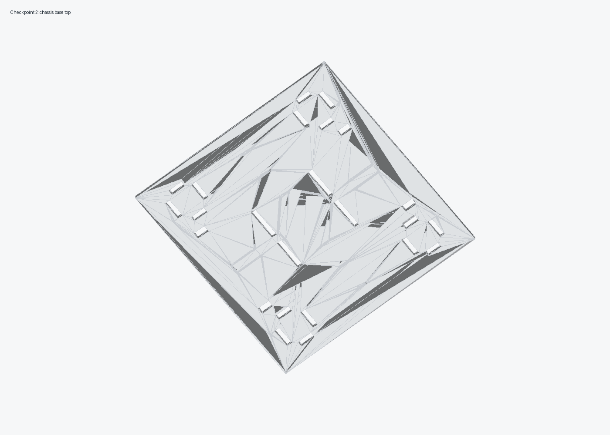
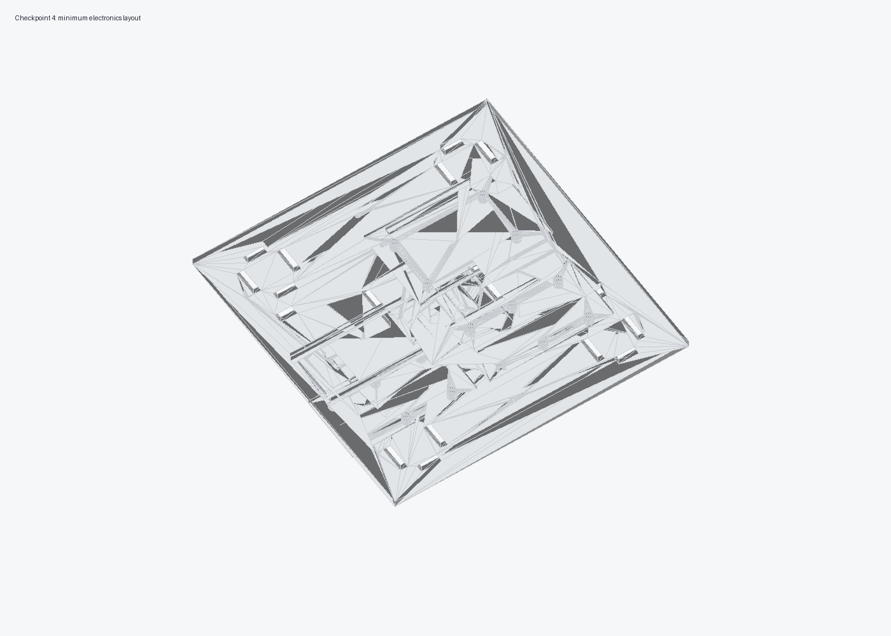

# CAD Validation Report

Generated with:

```sh
.venv-cad/bin/python -W error cad/source/generate_delivery_robot_cad.py
```

## Visual Checks

The generated minimum outdoor preview renders were opened and inspected during the CAD pass:






Inspection notes:

- The four-wheel layout clears the body panels.
- The chassis split pieces are under 220 x 220 mm.
- The top-down base render shows the split base plates, electronics trays, and wheel spacing in their expected positions.
- The front and rear panels are plain; the removed HC-SR04, LED, camera, and servo-lock features are no longer generated as baseline geometry.
- The food payload sits in the upper cargo bay on a printed shelf above the electronics bay.
- The maximum sealed food container envelope remains 205 x 145 x 70 mm.
- The electronics layout render includes only the Arduino tray, two BTS7960 trays, one battery sled, and one buck-converter plate.
- The print parts are flat-oriented or simple upright posts; no support-heavy geometry is required.
- The outdoor splash sheet is not rendered because it is a hand-cut flat consumable, not a printed CAD part.

## Mesh Checks

27 STL files were generated. All print-target STL files were checked with `trimesh` and are watertight. The only non-watertight STL is `cad/print-ready/full-size/v2_robot_complete_reference_not_for_print.stl`, which is intentionally a visual assembly reference made from overlapping printable parts plus motor/wheel/food-box placeholders.

Largest print files:

| File | Size |
| --- | --- |
| `chassis/base_plate_front_left.stl` | 162 x 165 x 8 mm |
| `chassis/base_plate_front_right.stl` | 162 x 165 x 8 mm |
| `chassis/base_plate_rear_left.stl` | 162 x 165 x 8 mm |
| `chassis/base_plate_rear_right.stl` | 162 x 165 x 8 mm |
| `body/side_panel_front_half_print_2.stl` | 150 x 155 x 6 mm |
| `body/side_panel_rear_half_print_2.stl` | 150 x 155 x 6 mm |
| `body/front_panel_left.stl` | 115 x 155 x 6 mm |
| `body/front_panel_right.stl` | 115 x 155 x 6 mm |
| `body/rear_panel_left.stl` | 115 x 155 x 6 mm |
| `body/rear_panel_right.stl` | 115 x 155 x 6 mm |
| `electronics/3s_lipo_battery_sled.stl` | 155 x 64 x 11 mm |
| `electronics/arduino_mega_controller_tray.stl` | 145 x 92 x 12 mm |
| `electronics/bts7960_dual_driver_tray_print_2.stl` | 136 x 72 x 12 mm |

The merged original repo base, `full-size/original_four_piece_base_merged_full_size.stl`, was also generated and validated as watertight.
