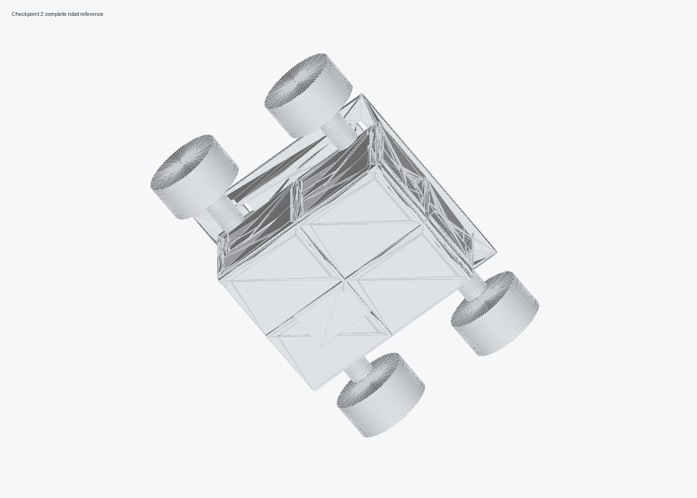
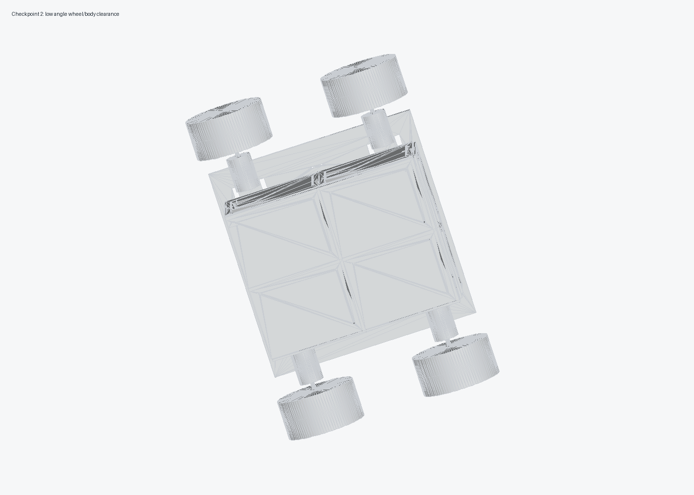
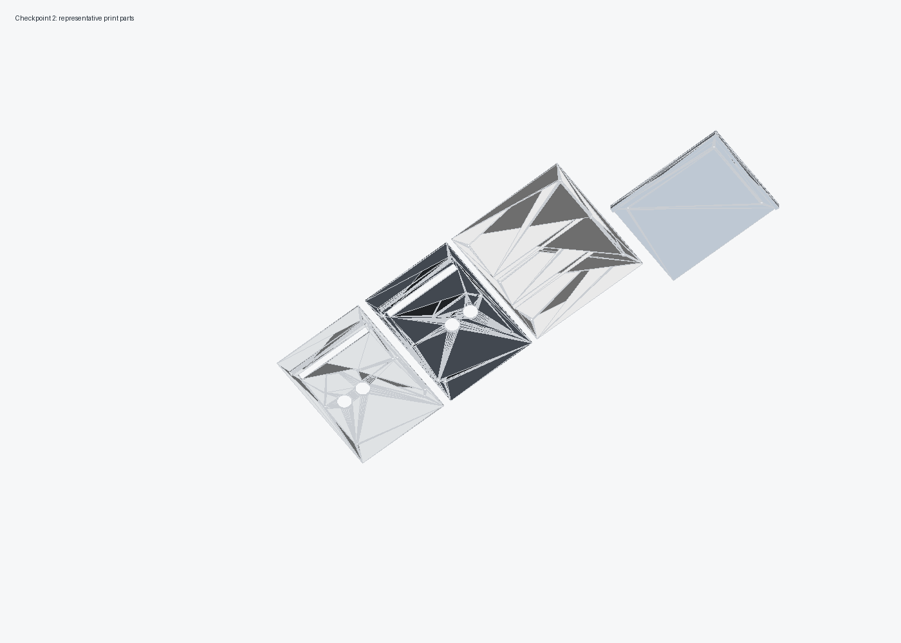
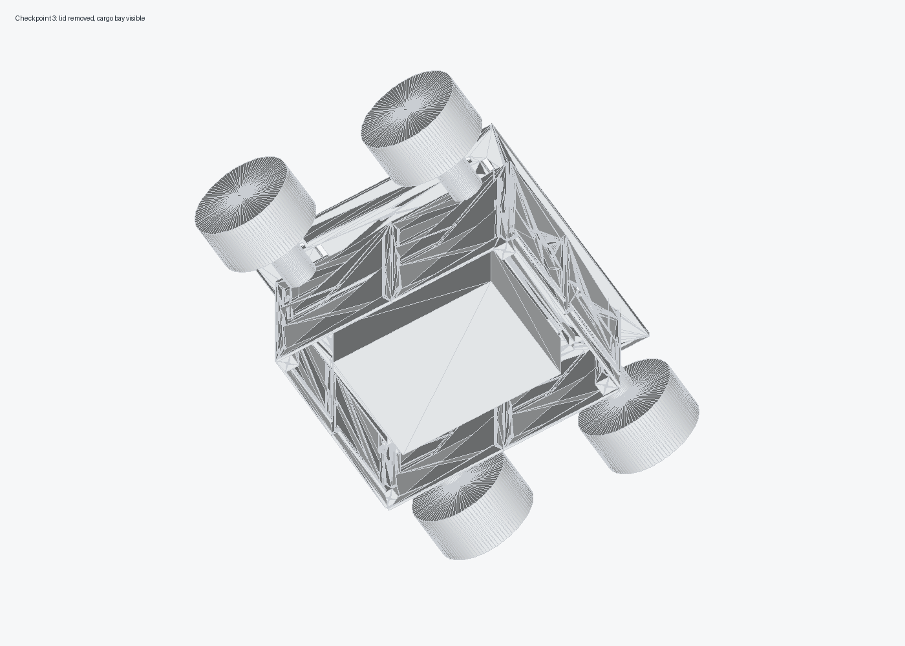
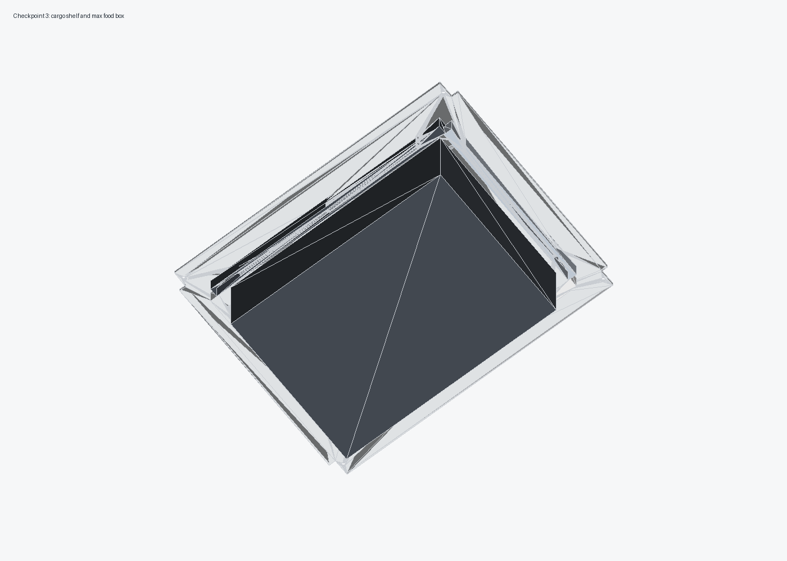

# CAD Validation Report

Generated with:

```sh
source .venv-cad/bin/activate
python cad/source/generate_delivery_robot_cad.py
```

## Visual Checks

The generated preview renders were opened and inspected during the CAD pass:











Inspection notes:

- The four-wheel layout clears the body panels.
- The chassis split pieces are under 220 x 220 mm.
- The front panels include two HC-SR04 openings and a front LED diffuser slot.
- The food payload sits in the upper cargo bay on a printed shelf, inside retainer rails, above the electronics bay.
- The maximum sealed food container envelope is 205 x 145 x 70 mm.
- The print parts are flat-oriented or simple upright posts; no support-heavy geometry is required.

## Mesh Checks

31 STL files were generated. All print-target STL files were checked with `trimesh` and are watertight. The only non-watertight STL is `cad/print-ready/full-size/v2_robot_complete_reference_not_for_print.stl`, which is intentionally a visual assembly reference made from overlapping printable parts plus motor/wheel/food-box placeholders.

Largest print files:

| File | Size |
| --- | --- |
| `chassis/base_plate_front_left.stl` | 162 x 165 x 8 mm |
| `chassis/base_plate_front_right.stl` | 162 x 165 x 8 mm |
| `chassis/base_plate_rear_left.stl` | 162 x 165 x 8 mm |
| `chassis/base_plate_rear_right.stl` | 162 x 165 x 8 mm |
| `cargo/cargo_retainer_long_rail_print_2.stl` | 224 x 8 x 16 mm |
| `cargo/cargo_retainer_short_rail_print_2.stl` | 8 x 156 x 16 mm |
| `body/side_panel_front_half_print_2.stl` | 150 x 155 x 6 mm |
| `body/side_panel_rear_half_print_2.stl` | 150 x 155 x 6 mm |
| `electronics/3s_lipo_battery_sled.stl` | 155 x 64 x 11 mm |

The merged original repo base, `full-size/original_four_piece_base_merged_full_size.stl`, was also generated and validated as watertight.
