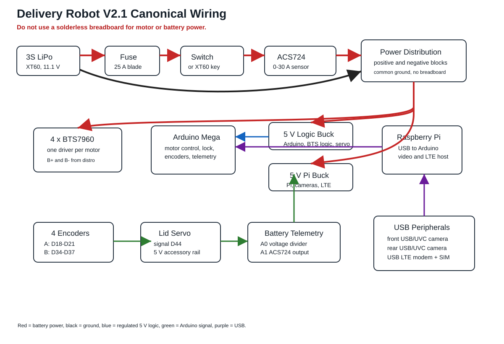

# Canonical V2.1 Wiring

This file is the wiring source of truth for the v2.1 build. The old root-level Fritzing/block-diagram image is legacy and incomplete.



## Non-Negotiable Safety Rules

- Do not route motor or battery power through a solderless breadboard.
- Keep the inline fuse within 100 mm of battery positive.
- Put the main switch or XT60 loop key after the fuse and before the rest of the robot.
- Use a real positive distribution block and a real negative distribution block.
- All grounds must be common: battery negative, Arduino ground, Pi buck ground, logic buck ground, BTS7960 grounds, servo ground, current-sensor ground, and voltage-divider ground.
- Never charge the LiPo through the robot wiring.

## Power Path

```text
3S LiPo XT60+
  -> 25 A blade fuse
  -> main switch or XT60 loop key
  -> Pololu ACS724 0-30 A current sensor IP+
  -> Pololu ACS724 current sensor IP-
  -> positive distribution block
  -> four BTS7960 B+ terminals
  -> logic/accessory 5 V buck input+
  -> Pi/camera/LTE 5 V buck input+

3S LiPo XT60-
  -> negative distribution block
  -> four BTS7960 B- terminals
  -> logic/accessory 5 V buck input-
  -> Pi/camera/LTE 5 V buck input-
```

## 5 V Rails

Use two buck converters:

| Rail | Loads | Notes |
| --- | --- | --- |
| Logic/accessory 5 V | Arduino Mega `5V`, BTS7960 `Vcc`, BTS7960 logic grounds, lid-lock servo, ACS724 sensor, voltage divider reference ground | Set to 5.0-5.1 V before connecting |
| Pi/camera/LTE 5 V | Raspberry Pi USB-C input, USB cameras, USB LTE modem | Use a separate 5 V 5 A buck and a rated USB-C power pigtail/breakout |

The two 5 V positive rails should stay separate. The grounds are common.

## Arduino Signal Map

### BTS7960 Motor Drivers

| Driver | Physical motor | RPWM | LPWM | R_EN | L_EN | R_IS | L_IS |
| --- | --- | ---: | ---: | ---: | ---: | ---: | ---: |
| `L1` | Front-left | D3 | D2 | D11 | D12 | D10 | D13 |
| `L2` | Rear-left | D7 | D6 | D23 | D24 | D22 | D25 |
| `R1` | Front-right | D5 | D4 | D47 | D48 | D46 | D49 |
| `R2` | Rear-right | D9 | D8 | D51 | D52 | D50 | D53 |

### Encoders

| Encoder | A channel | B channel | Power |
| --- | ---: | ---: | --- |
| `L1` front-left | D18 | D34 | 5 V and GND |
| `L2` rear-left | D19 | D35 | 5 V and GND |
| `R1` front-right | D20 | D36 | 5 V and GND |
| `R2` rear-right | D21 | D37 | 5 V and GND |

### Telemetry And Lock

| Function | Arduino pin | Wiring |
| --- | ---: | --- |
| Lid-lock servo signal | D44 | Servo red to 5 V accessory rail, brown/black to common ground |
| Battery voltage divider output | A0 | 100 kOhm top resistor from switched battery positive to A0; 33 kOhm bottom resistor from A0 to ground |
| ACS724 current sensor output | A1 | ACS724 `VIOUT` to A1, `VCC` to 5 V accessory rail, `GND` to common ground |

## Pi, Cameras, And LTE

- Raspberry Pi connects to the Arduino Mega by USB.
- Front USB/UVC camera connects to the Pi.
- Rear USB/UVC camera connects to the Pi.
- USB LTE modem connects to the Pi and needs its own activated SIM/data plan.
- The current Arduino sketch does not implement a web dashboard. It exposes serial commands and telemetry so the Pi can run the teleop software in the next phase.

## Serial Commands

At 9600 baud:

| Command | Action |
| --- | --- |
| `F` or `Forward` | Short forward pulse |
| `B`, `Back`, or `Reverse` | Short reverse pulse |
| `L` or `Left` | Short left pivot |
| `R` or `Right` | Short right pivot |
| `S` or `Stop` | Stop all motors |
| `LOCK` | Rotate servo to locked lid position |
| `UNLOCK` | Rotate servo to unlocked lid position |
| `STATUS`, `TELEMETRY`, or `T` | Print battery/current/lock/encoder telemetry |
| `ZEROENC` | Reset encoder counts to zero |

Telemetry prints as:

```text
TEL,V=12.10,I=1.25,LOW=0,LOCK=1,ENC=123/121/119/124
```
