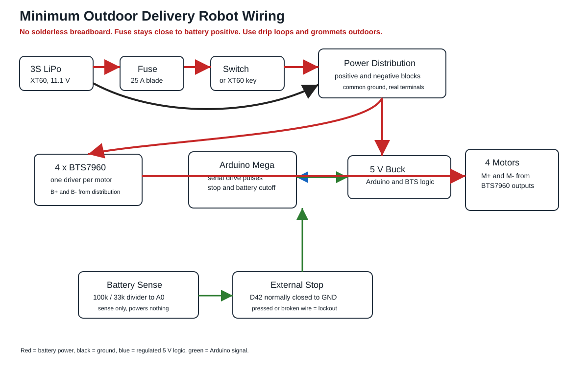

# Canonical Minimum Wiring

This file is the wiring source of truth for the first-principles outdoor baseline. The old root-level Fritzing/block-diagram image and the previous v2.2 wiring are historical and include parts that are no longer in the default build.



Outdoor means fair-weather splash resistance on pavement or packed paths. It does not mean rain, puddles, sprinklers, mud, or submersion.

## Non-Negotiable Safety Rules

- Do not route motor or battery power through a solderless breadboard.
- Keep the inline fuse within 100 mm of battery positive.
- Put the main switch or XT60 loop key after the fuse and before the rest of the robot.
- Use a real positive distribution block and a real negative distribution block.
- All grounds must be common: battery negative, Arduino ground, 5 V buck ground, and BTS7960 grounds.
- Never charge the LiPo through the robot wiring.
- The external stop button is a firmware drive-lockout input. It does not replace the main switch or XT60 loop key as the hard power disconnect.
- Install only one LiPo pack in the robot at a time.
- Route outdoor cables with drip loops, grommets or cable glands, and strain relief before they enter the electronics bay.
- Keep connectors and distribution blocks above the removable splash sheet and away from upward-facing water pockets.

## Power Path

```text
3S LiPo XT60+
  -> 25 A blade fuse
  -> main switch or XT60 loop key
  -> positive distribution block
  -> four BTS7960 B+ terminals
  -> 5 V buck input+

3S LiPo XT60-
  -> negative distribution block
  -> four BTS7960 B- terminals
  -> 5 V buck input-
```

## 5 V Rail

Use one 5 V buck converter:

| Rail | Loads | Notes |
| --- | --- | --- |
| Logic 5 V | Arduino Mega `5V`, BTS7960 `Vcc`, voltage-divider ground reference | Set to 5.0-5.1 V before connecting electronics |

Do not feed raw 3S battery voltage to the Arduino `5V` pin or any BTS7960 logic pin.

## Arduino Signal Map

### BTS7960 Motor Drivers

| Driver | Physical motor | RPWM | LPWM | R_EN | L_EN | R_IS | L_IS |
| --- | --- | ---: | ---: | ---: | ---: | ---: | ---: |
| `L1` | Front-left | D3 | D2 | D11 | D12 | D10 | D13 |
| `L2` | Rear-left | D7 | D6 | D23 | D24 | D22 | D25 |
| `R1` | Front-right | D5 | D4 | D47 | D48 | D46 | D49 |
| `R2` | Rear-right | D9 | D8 | D51 | D52 | D50 | D53 |

For every driver:

- BTS7960 `Vcc` goes to the regulated 5 V rail.
- BTS7960 `Gnd` goes to common ground.
- Use 22-26 AWG signal wire.
- Keep signal wires away from motor power wires where practical.

### Safety And Battery Sense

| Function | Arduino pin | Wiring |
| --- | ---: | --- |
| External stop input | D42 | Normally-closed stop switch contact from D42 to GND. Released/healthy = LOW; pressed or unplugged = HIGH |
| Battery voltage divider output | A0 | 100 kOhm top resistor from switched battery positive to A0; 33 kOhm bottom resistor from A0 to ground |

The voltage divider is only for sensing. It must not power anything.

## Serial Commands

At 9600 baud:

| Command | Action |
| --- | --- |
| `F` or `Forward` | Short forward pulse |
| `B`, `Back`, or `Reverse` | Short reverse pulse |
| `L` or `Left` | Short left pivot |
| `R` or `Right` | Short right pivot |
| `S` or `Stop` | Stop all motors |
| `STATUS`, `TELEMETRY`, or `T` | Print battery and stop-state telemetry |

Telemetry prints as:

```text
TEL,V=12.10,LOW=0,ESTOP=0
```
